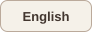
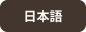
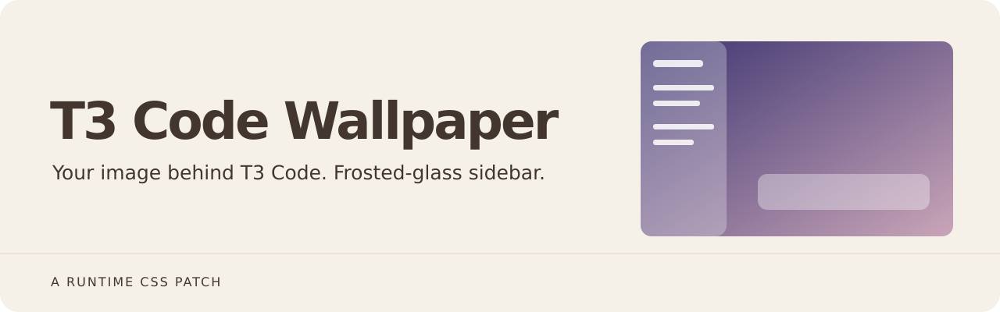
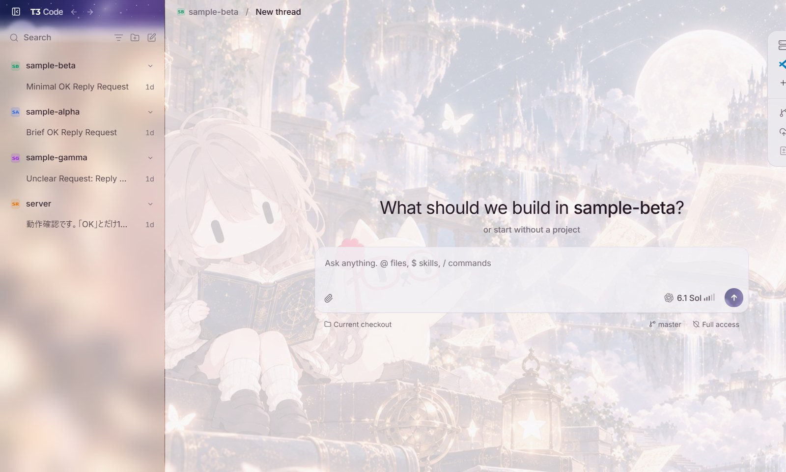
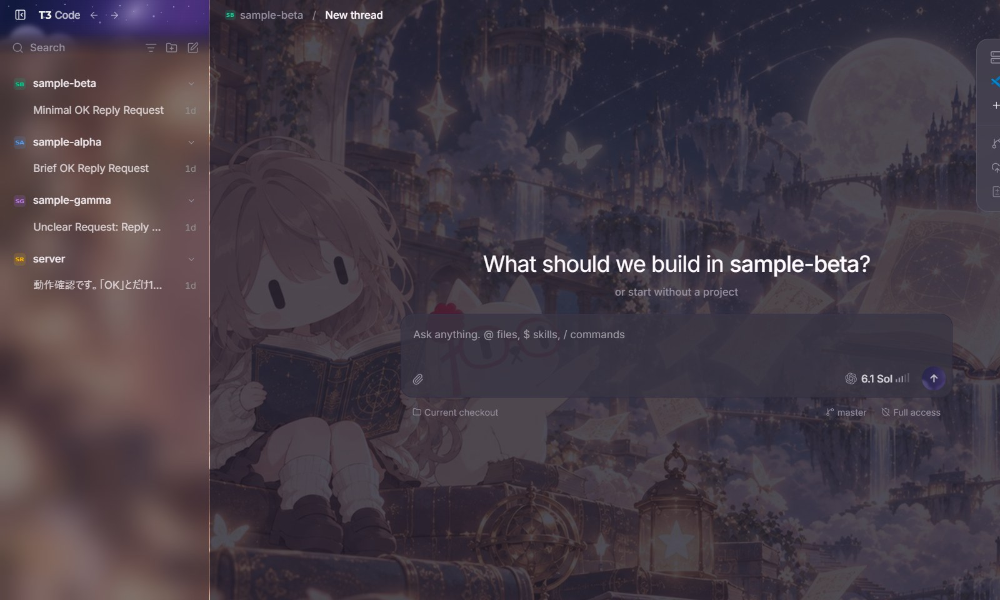

  
  

  

<h1 align="center">T3 Code 壁紙パッチ</h1>

**T3 Code (Nightly) の背景に好きな画像を敷き、サイドバーはぼかして透かす。** アプリのファイルは書き換えず、起動中のアプリに CSS を差し込むだけなので、自動更新で消えません。

## スクリーンショット

ライトテーマ:

ダークテーマ:

サイドバーは壁紙をぼかして透かしています（すりガラス）。撮影のため、サイドバーのスレッド一覧は一部を隠しています。それ以外は加工していません。

## 使い方

- `launch.bat` を指すショートカット（例: デスクトップの「T3 Code (壁紙付き)」）から起動する。通常のショートカットで起動すると壁紙は付きません。
- すでに T3 Code が通常モードで動いている場合は、いったん終了してから開いてください。

## 設定（`config.json`）

| キー | 意味 |
|---|---|
| `image` | 画像のパス（このフォルダからの相対、または絶対）。jpg/png。1〜2MB 程度までを勧めます。 |
| `veil` | 画像の上に重ねる画面色の濃さ（0〜100）。大きいほど文字が読みやすく、壁紙は薄くなります。 |
| `sidebar` | `true` で左のサイドバーも半透明にし、壁紙を透かしてぼかします。 |
| `sidebarVeil` | サイドバーに重ねる画面色の濃さ（0〜100）。小さいほど壁紙が透けます。既定は 55。 |
| `sidebarBlur` | サイドバーのぼかしの強さ（px）。既定は 18。`0` でぼかし無し。 |
| `port` | デバッグ用ポート。 |

設定を変えたら、T3 Code を終了して、ショートカットから開き直してください。

## 仕組みと注意

- `--remote-debugging-port` を 127.0.0.1 限定で付けて起動し、`inject.mjs` が Chrome DevTools Protocol で接続して `<style>` を差し込みます。
- そのポートは、同じPC上の他のプログラムがアプリを操作できる状態になります。気になる場合は、壁紙が要らない時は通常のショートカットで起動してください。
- アプリの更新で画面の構造が変わると、壁紙が効かなくなることがあります。その場合は `inject.mjs` の CSS を直してください。
- 外すには、壁紙付きショートカットを使わないだけです。

## 必要なもの

- Windows、`%LOCALAPPDATA%\Programs\t3code` に入れた T3 Code (Nightly)、Node.js 22 以上（組み込みの WebSocket を使います）。
- 動作を確かめたのは Windows 11 と T3 Code Nightly 0.1.7 だけです。

## ライセンス

- コード: MIT（`LICENSE`）。
- `wallpaper.jpg` は、T3 Code のリポジトリ（MIT、© 2026 T3 Tools Inc.）にある `custom-header-backdrop.png` を JPEG に縮めたものです。好きな画像に差し替えてかまいません。
