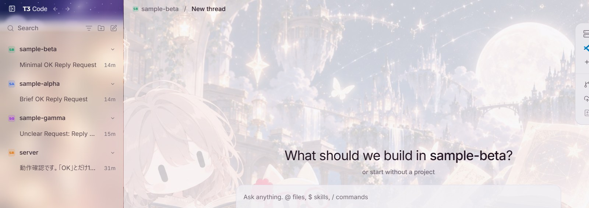

# T3 Code 壁紙パッチ

T3 Code (Nightly) の背景に画像を敷く。アプリのファイルは書き換えず、起動中のアプリに CSS を差し込む。自動更新で消えない。

## 使い方
- デスクトップの「T3 Code (壁紙付き)」から起動する。通常のショートカットで起動すると壁紙は付かない。
- すでに T3 Code が通常モードで動いている場合は、いったん終了してから開く。

## 設定（config.json）
- `image`: 画像のパス（このフォルダからの相対、または絶対）。jpg/png。大きい画像は重くなるので、1〜2MB 程度までを勧める。
- `veil`: 画像の上に重ねる画面色の濃さ（0〜100）。大きいほど文字が読みやすく、壁紙は薄くなる。
- `sidebar`: true にすると、左のサイドバーも半透明にして、壁紙を透かしてぼかす（すりガラス）。
- `sidebarVeil`: サイドバーに重ねる画面色の濃さ（0〜100）。小さいほど壁紙が透ける。今は55。
- `sidebarBlur`: サイドバーのぼかしの強さ（px）。今は18。大きいほど絵がぼやける。0でぼかし無し。
- `port`: デバッグ用ポート。

設定を変えたら、T3 Code を終了して、ショートカットから開き直す。

## 仕組みと注意
- `--remote-debugging-port` を 127.0.0.1 限定で付けて起動し、`inject.mjs` が接続して CSS を差し込む。
- そのポートは、同じPC上の他のプログラムがアプリを操作できる状態になる。気になる場合は使わない時に通常のショートカットで起動する。
- アプリの更新で画面の構造が変わると、壁紙が効かなくなることがある。その場合は `inject.mjs` の CSS を直す。
- 外すには、壁紙付きショートカットを使わないだけでよい。

## 必要なもの
- Windows、T3 Code (Nightly)（`%LOCALAPPDATA%\Programs\t3code` に入れた版）、Node.js 22 以上（組み込みの WebSocket を使う）。
- 動作を確かめたのは Windows 11 と T3 Code Nightly 0.1.7 だけ。

## ライセンス
- コードは MIT（`LICENSE`）。
- `wallpaper.jpg` は、T3 Code のリポジトリ（MIT、© 2026 T3 Tools Inc.）にある `custom-header-backdrop.png` を JPEG に縮めたもの。好きな画像に差し替えてよい。
