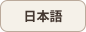
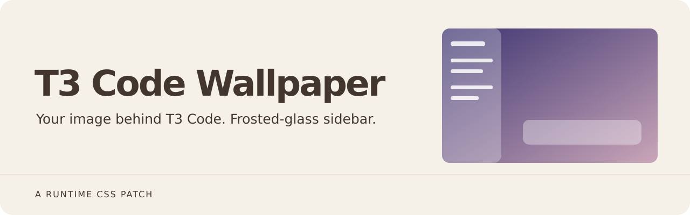
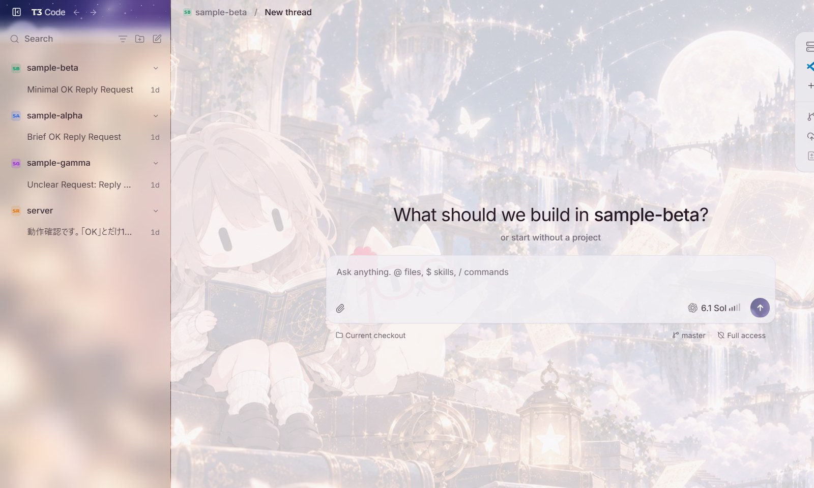
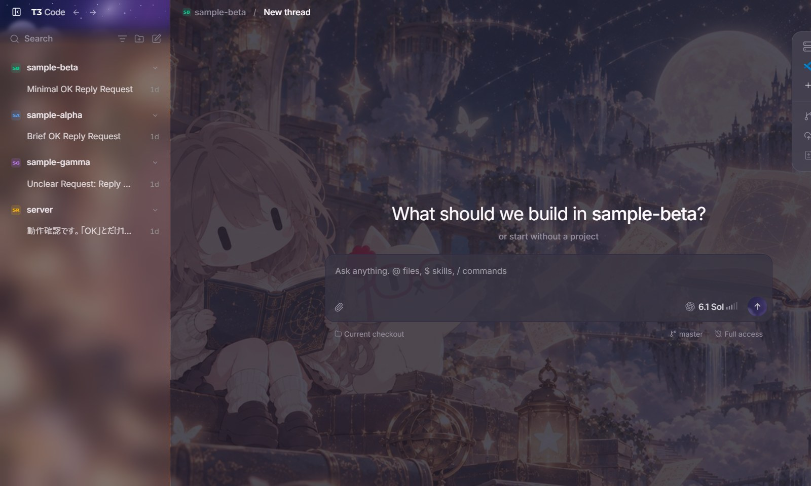

  
  

  

<h1 align="center">T3 Code Wallpaper</h1>

**Put your own image behind T3 Code (Nightly), and blur it through the sidebar.** The app's files are never modified: a small script injects CSS into the running app, so auto-updates do not remove it.

## Screenshots

Light theme:

Dark theme:

The sidebar shows the wallpaper through a blur (frosted glass). The sidebar's thread list was trimmed for the screenshots; the app was not otherwise altered.

## Use

- Start T3 Code from the `launch.bat` shortcut (e.g. a desktop shortcut named "T3 Code (wallpaper)"). A normal shortcut starts it without the wallpaper.
- If T3 Code is already running in normal mode, quit it first.

## Configure (`config.json`)

| Key | Meaning |
|---|---|
| `image` | Image path (relative to this folder, or absolute). jpg/png. Keep it to about 1–2 MB. |
| `veil` | Opacity of the theme color laid over the image, 0–100. Higher means more readable text and a fainter wallpaper. |
| `sidebar` | `true` makes the sidebar translucent and blurs the wallpaper behind it. |
| `sidebarVeil` | Opacity of the theme color over the sidebar, 0–100. Lower shows more wallpaper. Default 55. |
| `sidebarBlur` | Sidebar blur in px. Default 18. `0` disables blur. |
| `port` | Debug port. |

After changing the config, quit T3 Code and start it again from the shortcut.

## How it works, and caveats

- The app is started with `--remote-debugging-port` bound to 127.0.0.1, and `inject.mjs` connects over the Chrome DevTools Protocol to inject a `<style>`.
- That port lets other programs on the same PC drive the app. If that concerns you, start it from the normal shortcut when you do not need the wallpaper.
- If an app update changes the page structure, the wallpaper may stop working. Adjust the CSS in `inject.mjs`.
- To remove it, simply stop using the wallpaper shortcut.

## Requirements

- Windows, T3 Code (Nightly) installed under `%LOCALAPPDATA%\Programs\t3code`, and Node.js 22 or later (uses the built-in WebSocket).
- Tested only on Windows 11 with T3 Code Nightly 0.1.7.

## License

- Code: MIT (`LICENSE`).
- `wallpaper.jpg` is a JPEG downscale of `custom-header-backdrop.png` from the T3 Code repository (MIT, © 2026 T3 Tools Inc.). Replace it with any image you like.
